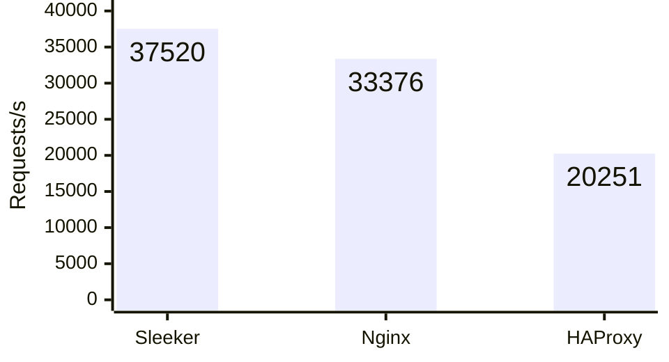

# Sleeker v0.0.25

<p align="center">
  
</p>

<p align="center">
  <strong>A high-performance HTTP/1.1 and HTTP/2 server library for modern Java.</strong>
</p>

<p align="center">
  
  
  
  
</p>

---

## About Sleeker

Sleeker is a high-performance **HTTP/1.1 and HTTP/2 server library for Java 25**, built on [Netty](https://netty.io/).

It combines non-blocking I/O, virtual threads, and native transports such as **io_uring, epoll, and kqueue**.

With TLS/ALPN, flexible routing, CORS, efficient file streaming, and configurable concurrency and timeouts, Sleeker is designed for responsive, scalable HTTP services.

## Quick Start

Get started with Sleeker by creating a request handler and configuring the HTTP server.

### 1. Create an HTTP/1.1 Handler

Extend `Http1SleekHandler` to define how your application processes incoming requests.

```java
public class Http1ExampleApiHandler extends Http1SleekHandler {

    @Override
    protected void handleGET(Http1Request http1Request, Http1Response http1Response) throws InterruptedException {
        TimeUnit.MILLISECONDS.sleep(1);
        http1Response.addHeader(HttpHeaderNames.CONTENT_TYPE, ContentType.TEXT_PLAIN_UTF8.getMimeType());
        http1Response.reply("Hello from HTTP/1.1", HttpResponseStatus.OK);
    }

    @Override
    protected void handlePOST(Http1Request http1Request, Http1Response http1Response) {
        http1Response.addHeader(HttpHeaderNames.CONTENT_TYPE, ContentType.TEXT_PLAIN_UTF8.getMimeType());
        http1Response.reply("Saved! (HTTP/1.1)", HttpResponseStatus.CREATED);
    }
}
```

### 2. Start the Server

Configure TLS, register your routes, and select the preferred I/O transport.

```java
public class Application {

    static void main() throws Exception {

        new SleekerServer.Builder()
                .withSsl(Path.of("/tls/localhost-cert.pem"), Path.of("/tls/localhost-key.pem"))
                .addHttp1Context("/http1_get_post", new Http1ExampleApiHandler(), HttpMethod.GET, HttpMethod.POST)
                .build()
                .startServer(new InetSocketAddress("0.0.0.0", 8080), ServerIo.TYPE_EPOLL);
    }
}
```

---

## Performance Benchmarks

Sleeker demonstrates strong HTTP/1.1 performance, achieving **higher throughput and lower average latency** than Nginx and HAProxy under the tested workload.

All three servers were benchmarked using identical request concurrency, duration, response size, and an intentional **1 ms processing delay per request**.

### Throughput Comparison

**Requests per Second - Higher is Better**



### Benchmark Results

| Metric | Sleeker | Nginx | HAProxy |
|:---|---:|---:|---:|
| **Requests/sec** | **37,520 🏆** | 33,376 | 20,251 |
| **Total Requests** | **375,285 🏆** | 333,872 | 202,589 |
| **Average Latency** | **1.331 ms 🏆** | 1.497 ms | 2.465 ms |
| **P50 Latency** | **1.341 ms 🏆** | 1.641 ms | 3.022 ms |
| **P95 Latency** | **1.422 ms 🏆** | 1.955 ms | 3.716 ms |
| **P99 Latency** | **1.518 ms 🏆** | 2.127 ms | 4.044 ms |
| **Success Rate** | 100% | 100% | 100% |

### Performance Highlights

Under this benchmark workload, Sleeker achieved:

- **12.4% higher throughput** compared to Nginx.
- **85.3% higher throughput** compared to HAProxy.
- **Lower average, P50, P95, and P99 response latencies** than both alternatives.
- **100% successful responses** across all 375,285 requests.

### Test Configuration

| Parameter | Configuration |
|:---|:---|
| **Benchmark Tool** | [oha](https://github.com/hatoo/oha) |
| **HTTP Protocol** | HTTP/1.1 |
| **Test Duration** | 10 seconds per server |
| **Concurrent Connections** | 50 |
| **Endpoint** | `/http1_get_post` |
| **Response Size** | 19 bytes |
| **Processing Delay** | 1 ms per request |
| **Test Environment** | Local network (`192.168.***.***`) |

> [!IMPORTANT]
> **Intentional Processing Delay**
>
> Every request includes a deliberately introduced **1 ms processing delay** across all three servers to simulate application workload. This delay is included in the reported response times.

> [!NOTE]
> **Benchmark Disclaimer**
>
> These results represent a specific HTTP/1.1 workload under the described test conditions. They should not be interpreted as a universal performance ranking.
>
> Actual performance may vary depending on hardware, operating system, server configuration, network conditions, and application workload.

---