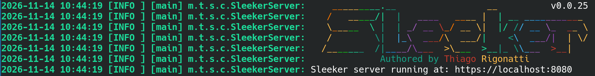

# Sleeker v0.0.25

<p align="center">
  
</p>

<p align="center">
  <strong>A high-performance HTTP/1.1 and HTTP/2 server library for modern Java.</strong>
</p>

<p align="center">
  
  
  
  
</p>

---

## About Sleeker

Sleeker is a high-performance **HTTP/1.1 and HTTP/2 server library for Java 25**, built on [Netty](https://netty.io/).

It combines non-blocking I/O, virtual threads, and native transports such as **io_uring, epoll, and kqueue**.

With TLS/ALPN, flexible routing, CORS, efficient file streaming, and configurable concurrency and timeouts, Sleeker is designed for responsive, scalable HTTP services.

## Quick Start

Get started with Sleeker by creating a request handler and configuring the HTTP server.

### 1. Create an HTTP/1.1 Handler

Extend `Http1SleekHandler` to define how your application processes incoming requests.

```java
public class Http1ExampleApiHandler extends Http1SleekHandler {

    @Override
    protected void handleGET(Http1Request http1Request, Http1Response http1Response) throws InterruptedException {
        TimeUnit.MILLISECONDS.sleep(1);
        http1Response.addHeader(HttpHeaderNames.CONTENT_TYPE, ContentType.TEXT_PLAIN_UTF8.getMimeType());
        http1Response.reply("Hello from HTTP/1.1", HttpResponseStatus.OK);
    }

    @Override
    protected void handlePOST(Http1Request http1Request, Http1Response http1Response) {
        http1Response.addHeader(HttpHeaderNames.CONTENT_TYPE, ContentType.TEXT_PLAIN_UTF8.getMimeType());
        http1Response.reply("Saved! (HTTP/1.1)", HttpResponseStatus.CREATED);
    }
}
```

### 2. Start the Server

Configure TLS, register your routes, and select the preferred I/O transport.

```java
public class Application {

    static void main() throws Exception {

        new SleekerServer.Builder()
                .withSsl(Path.of("/tls/localhost-cert.pem"), Path.of("/tls/localhost-key.pem"))
                .addHttp1Context("/http1_get_post", new Http1ExampleApiHandler(), HttpMethod.GET, HttpMethod.POST)
                .build()
                .startServer(new InetSocketAddress("0.0.0.0", 8080), ServerIo.TYPE_EPOLL);
    }
}
```